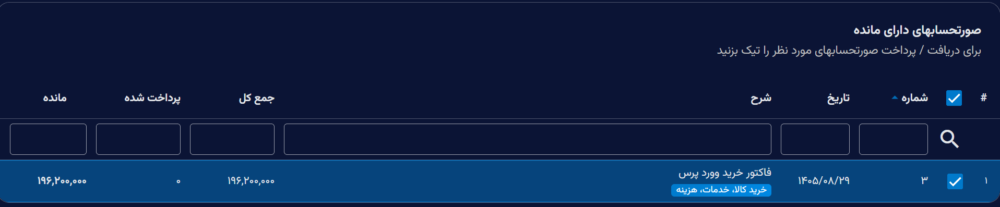

# ثبت پرداخت وجه به مخاطب در لاندا

برای ثبت وجه پرداختی به فروشنده یا مخاطب، از «دریافت و پرداخت» به [پرداخت‌ها](https://spa.landa-sme.ir/Trs/Payment) بروید و روی «ایجاد» کلیک کنید. [فرم ایجاد پرداخت](https://spa.landa-sme.ir/trs/payment/create) نیز به‌صورت مستقیم در دسترس است.

## انتخاب مخاطب

نام مخاطبی را که وجه را به او پرداخت کرده‌اید، در فیلد «مخاطب» انتخاب کنید. اگر نام او در فهرست نیست، ابتدا اطلاعاتش را در [فرم ایجاد مخاطب](https://spa.landa-sme.ir/crm/customer/create) ثبت کنید.

برچسب وضعیت حساب زیر نام مخاطب را بررسی کنید.

- «بستانکار» نشان می‌دهد کسب‌وکار بابت ماندهٔ نمایش‌داده‌شده به مخاطب بدهکار است.
- «بدهکار» نشان می‌دهد مخاطب بابت ماندهٔ نمایش‌داده‌شده به کسب‌وکار بدهکار است.

برای بررسی سابقه و ماندهٔ مخاطب، گردش حساب او را مشاهده کنید. نبودن برچسب می‌تواند نیازمند بررسی وضعیت حساب یا نحوهٔ نمایش آن باشد.

## ارتباط پرداخت با صورتحساب

اگر پرداخت بابت خرید یا برگشت از فروش است، صورتحساب مربوط را در جدول «صورتحساب‌های دارای مانده» انتخاب کنید. جدول، شماره، تاریخ، شرح، جمع کل، مبلغ پرداخت‌شده و ماندهٔ هر صورتحساب را نشان می‌دهد.

برای پرداخت‌های فاقد صورتحساب مرتبط، متن ارسالی به بخش «سایر هزینه» اشاره می‌کند. عنوان و کاربرد دقیق این بخش در فرم پرداخت نیازمند تأیید است.

## انتخاب روش پرداخت

با توجه به نحوهٔ پرداخت وجه، یکی از گزینه‌های «نقدی»، «واریز بانکی»، «چک» یا «طرف حساب» را انتخاب و اطلاعات مربوط را تکمیل کنید.
