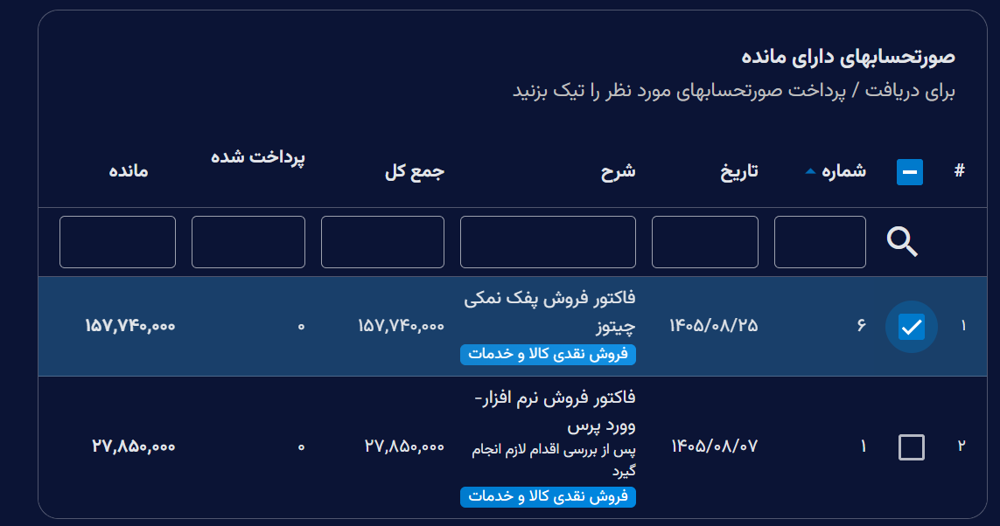

# ثبت دریافت وجه از مخاطب در لاندا

برای ثبت وجه دریافتی از مشتری یا مخاطب، از «دریافت و پرداخت» به [دریافت‌ها](https://spa.landa-sme.ir/Trs/Receipt) بروید و روی «ایجاد» کلیک کنید. [فرم ایجاد دریافت](https://spa.landa-sme.ir/trs/receipt/create) نیز به‌صورت مستقیم در دسترس است.

## انتخاب مخاطب

نام مخاطبی را که وجه را از او دریافت کرده‌اید، در فیلد «مخاطب» انتخاب کنید. اگر نام او در فهرست نیست، ابتدا اطلاعاتش را در [فرم ایجاد مخاطب](https://spa.landa-sme.ir/crm/customer/create) ثبت کنید.

برچسب وضعیت حساب زیر نام مخاطب را بررسی کنید.

- «بدهکار» نشان می‌دهد مخاطب بابت ماندهٔ نمایش‌داده‌شده به کسب‌وکار بدهکار است.
- «بستانکار» نشان می‌دهد کسب‌وکار بابت ماندهٔ نمایش‌داده‌شده به مخاطب بدهکار است.

برای بررسی سابقه و ماندهٔ مخاطب، گردش حساب او را مشاهده کنید. نبودن برچسب می‌تواند نیازمند بررسی وضعیت حساب یا نحوهٔ نمایش آن باشد.

## ارتباط دریافت با صورتحساب

اگر دریافت بابت فروش یا برگشت از خرید است، صورتحساب مربوط را در جدول «صورتحساب‌های دارای مانده» انتخاب کنید. جدول، شماره، تاریخ، شرح، جمع کل، مبلغ پرداخت‌شده و ماندهٔ هر صورتحساب را نشان می‌دهد.

برای دریافت‌های فاقد صورتحساب مرتبط، متن ارسالی به بخش «سایر هزینه» اشاره می‌کند. عنوان و کاربرد دقیق این بخش در فرم دریافت نیازمند تأیید است.

## انتخاب روش دریافت

با توجه به نحوهٔ دریافت وجه، یکی از گزینه‌های «نقدی»، «واریز بانکی»، «چک» یا «طرف حساب» را انتخاب و اطلاعات مربوط را تکمیل کنید.
